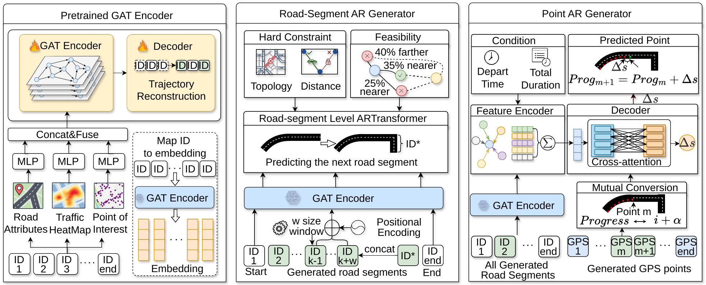
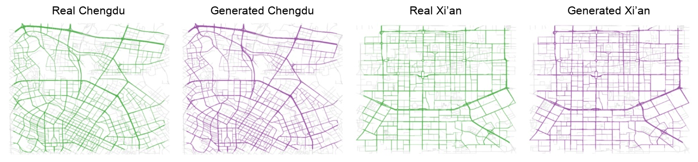

# [NeurIPS 2026] XTraj: A Coarse-to-Fine Autoregressive Framework for Transferable Trajectory Generation

> XTraj is a transferable coarse-to-fine autoregressive framework for road-consistent trajectory generation.

## Authors

**Chao Wang**<sup>1,*</sup>, **Zhiquan Lai**<sup>1,*</sup>, **Xinwei Fang**<sup>3</sup>, **Yuanshao Zhu**<sup>2,†</sup>, **Xun Zhou**<sup>1</sup>, **James Jianqiao Yu**<sup>1</sup>

<sup>1</sup> School of Computer Science and Technology, Harbin Institute of Technology, Shenzhen, China<br>
<sup>2</sup> City University of Hong Kong, Hong Kong SAR, China<br>
<sup>3</sup> Department of Computer Science, University of York, York, United Kingdom<br>
<sup>*</sup> Equal contribution; <sup>†</sup> Corresponding author

Contact: [Chao Wang](mailto:chaow@stu.hit.edu.cn), [Zhiquan Lai](mailto:zhiquanlai@stu.hit.edu.cn), [Yuanshao Zhu](mailto:yuanshao@ieee.org), [Xun Zhou](mailto:zhouxun2023@hit.edu.cn), [James Jianqiao Yu](mailto:jqyu@ieee.org)

## Links

- **Code Repository**: [GitHub](https://github.com/markLaiunimelb/XTraj)


## Table of Contents

- [Updates](#updates)
- [Introduction](#introduction)
- [Highlights](#highlights)
- [Framework](#framework)
- [Project Structure](#project-structure)
- [Installation](#installation)
- [Dataset](#dataset)
- [Usage](#usage)
- [Results](#results)
- [Visualization](#visualization)
- [TODO](#todo)
- [Citation](#citation)
- [Acknowledgement](#acknowledgement)
- [License](#license)

## Updates

- [10/2026] Initial code release.

## Introduction

This repository provides the official implementation of **“XTraj: A
Coarse-to-Fine Autoregressive Framework for Transferable Trajectory Generation.”**

**XTraj** addresses three challenges in vehicle trajectory generation:
geographic overfitting, fixed-length output, and off-road GPS drift. It combines
multimodal road representation learning with a coarse-to-fine autoregressive
pipeline: a GATv2 encoder learns road embeddings from geometry, POI context,
traffic heat, and topology; a road-level generator produces connected routes;
and a GPS-level decoder predicts monotonic progress along those routes.

This design supports variable-length generation and cross-city transfer without
additional parameter training, while keeping generated GPS points on road
geometry without post-hoc map matching. Experiments on Xi’an and Chengdu
demonstrate improved spatial fidelity over competitive baselines.

This source release includes the GAT road encoder, candidate-road Transformer,
v7 point decoder, one-epoch training functions, and trajectory generation APIs.
The caller supplies prepared tensors and data loaders and controls training
schedules, checkpoint persistence, and distributed launch. Dataset preprocessing
and evaluation scripts are outside this release.

## Highlights

- **Transferable road representations:** a multimodal GATv2 encoder combines
  road geometry, POI context, traffic heat, and directed graph topology.
- **Variable-length route generation:** an autoregressive road-segment generator
  applies neighbor and destination-directed constraints during decoding.
- **Road-consistent GPS refinement:** a route-aligned progress decoder predicts
  non-negative progress increments and interpolates points on road geometry.
- **Cross-city transfer:** the paper evaluates training-free transfer across
  Xi'an and Chengdu, with additional unseen-city transfer analysis in the appendix.
- **Fine-grained fidelity:** multi-resolution spatial evaluation and road-alignment
  analysis measure both distributional realism and physical validity.

## Framework

XTraj uses a coarse-to-fine, three-stage generation pipeline. The road-level
modules operate on a directed road graph, while the final module generates
route-relative progress values instead of unconstrained longitude/latitude
coordinates. The framework diagram below summarizes the pretrained GAT road
encoder, the constrained road-segment autoregressive generator, and the
point-level autoregressive generator that converts route progress into GPS
points; [the original PDF is available here](assets/framework/XTraj.pdf).



1. **Transferable road-segment encoder** (`models/gat_multimodal_encoder.py`)
   projects road attributes, POI context, and historical traffic heat into a shared
   representation and propagates it with a multi-head GATv2 over the directed
   road graph. A masked trajectory reconstruction objective masks 30% of
   interior road tokens and trains the encoder to recover them. The resulting
   64-dimensional road embeddings are computed and frozen for downstream use.
   The released training API uses the transfer-oriented configuration with the
   absolute-geometry branch disabled (`geo_in_dim=0`).
2. **Road-segment autoregressive generator**
   (`models/candidate_road_transformer.py`) predicts the next road segment from the
   route prefix, departure-time period, and destination-aware candidate
   attributes. Candidates are reachable, unvisited outgoing neighbors, sorted
   by road ID and capped at five. During decoding, an optional destination-
   directed shortest-path constraint filters candidates that would move farther
   from the destination, with a fallback when none satisfy the constraint.
   Generation stops when the destination is reached, producing variable-length
   routes.
3. **Road-aligned GPS generator** (`models/road_progress_decoder.py`) represents
   each point as `s = i + alpha`, where `i` is the route segment index and
   `alpha` is the within-segment arc-length ratio. An encoder-decoder Transformer
   predicts non-negative along-road displacements. The released v7 configuration
   rolls out metric positions with endpoint bounds and position supervision.
   Each predicted progress value is deterministically interpolated on the
   selected road polyline, keeping generated GPS points on valid road geometry.

The implementation is organized into model definitions in `models/`, training
steps in `training/`, generation APIs in `generation/`, and condition encoding
and geometry helpers in `utils/`.

## Project Structure

```text
.
├── assets/                              # Paper figures used in this README
│   ├── framework/                       # Framework diagram (PNG and PDF)
│   └── visualization/                   # City-level trajectory comparisons
├── models/                              # Neural network definitions
│   ├── gat_multimodal_encoder.py         # Transferable GATv2 road encoder
│   ├── masked_reconstruction.py          # Masked-road reconstruction Transformer
│   ├── candidate_road_transformer.py     # Destination-aware candidate scorer
│   └── road_progress_decoder.py         # Road-aligned point decoder
├── training/                            # One-epoch updates on prepared batches
│   ├── encoder.py                       # Joint encoder/reconstruction training
│   ├── routes.py                        # Candidate cross entropy and embedding wrapper
│   └── points.py                        # autoregressive position loss
├── generation/                          # In-memory inference APIs
│   ├── encoder.py                       # Compute frozen city road embeddings
│   ├── requests.py                      # Origin, destination, and trip conditions
│   ├── routes.py                        # Autoregressive road generation
│   ├── points.py                        # Three-second point decoding
│   └── trajectories.py                  # End-to-end route and GPS generation
├── utils/                               # Candidate features, time, and geometry
├── requirements.txt
├── NOTICE.md                            # Source provenance
├── README.zh-CN.md
└── README.md
```

This release exposes Python functions rather than command-line entry points.
Run the examples below from the repository root so the local packages can be
imported.

## Installation

Use **Python 3.10 or newer**.

### 1. Obtain the source

```bash
git clone https://github.com/markLaiunimelb/XTraj.git
cd XTraj
```

If you downloaded the source release, open its root directory instead.

### 2. Create an environment

```bash
python -m venv .venv
source .venv/bin/activate       # Linux / macOS
# .venv\Scripts\activate      # Windows
```

### 3. Install dependencies

Install a **PyTorch 2.7 or newer** build compatible with your hardware and CUDA
driver, then install the release dependencies:

```bash
python -m pip install -r requirements.txt
```

The requirements are `numpy>=1.24`, `torch>=2.7`, and `torch-geometric>=2.3`.
For PyTorch/CUDA-specific wheels, see the
[PyTorch Geometric installation guide](https://pytorch-geometric.readthedocs.io/en/latest/install/installation.html).
The examples select CUDA when available and otherwise use CPU.

## Dataset

The paper evaluates XTraj on real-world vehicle trajectories from **DIDI
Chuxing** in Xi'an and Chengdu. The road networks are directed graphs extracted
from **OpenStreetMap**, and POI context is collected from the **AMap API**.
Historical road-segment visit frequencies provide the traffic-heat features.

The dataset is not redistributed with this repository. Prepare city-specific
graph tensors, training batches, and map attributes with your own data pipeline.
The training interfaces consume tensors directly; they do not require a fixed
data-root layout or read raw trajectory files.

For generation, `RoadFeatureStore` reads existing map and attribute artifacts.
The following names are examples; pass their paths explicitly:

```text
/path/to/city/
├── edges.csv                 # Directed roads: fid, u, v, length, wkt
├── poi_levels.json           # POI counts and level-encoded attributes
├── density_levels.json       # Optional road-density statistics
├── speed_stats.json          # Road-speed statistics by departure period
└── length_dist.npy           # Prepared N x N road-to-destination distances
```

Road IDs must be consecutive `0..N-1` and match the graph tensors, embedding
rows, attribute files, and distance-table axes. `edges.csv` must include
positive lengths in metres and directed WKT `LINESTRING` geometry in longitude/
latitude order. The point-generation network requires every road ID to be
present. Distance entries must be finite and non-negative for reachable pairs;
use negative or non-finite entries for unreachable pairs. Zero distance,
including the destination's distance to itself, is valid.

The POI JSON contains `categories` and per-road `roads` records keyed by `fid`,
with counts and levels for eight POI categories. The speed JSON contains
per-road `speeds_by_period` statistics for `late_night`, `morning_peak`,
`daytime`, `evening_peak`, and `night`. An optional density JSON contains
`density_score_by_fid` and `density_level_by_fid`. See
[`utils/candidate_features.py`](utils/candidate_features.py) for the full
attribute schema and level definitions; use `feature_mode="levels"` to match
the released road model.

The DIDI, OpenStreetMap, and AMap terms of use apply to their respective data.
Users should obtain and process those sources according to the original
providers' access and licensing requirements.

## Usage

The examples follow the three stages in one Python session. Supply
`encoder_loader`, `route_loader`, `point_loader`, and the graph tensors from
your data pipeline. Each `train_epoch` call updates the supplied models for
one epoch in memory. The caller controls epoch loops, learning rates,
validation, logging, and weight saving/loading.

### Stage 1: Train the road encoder

```python
import torch
from models.gat_multimodal_encoder import EncoderConfig, MultiModalGATv2Encoder
from models.masked_reconstruction import (
    MaskedTrajectoryReconstructionConfig,
    MaskedTrajectoryReconstructionTransformer,
)
from training.encoder import train_epoch as train_encoder_epoch

# x_features, x_heat, edge_index, and encoder_loader are caller-prepared.
device = torch.device("cuda" if torch.cuda.is_available() else "cpu")
encoder = MultiModalGATv2Encoder(EncoderConfig()).to(device)
reconstructor = MaskedTrajectoryReconstructionTransformer(
    MaskedTrajectoryReconstructionConfig()
).to(device)
encoder_optimizer = torch.optim.AdamW(
    list(encoder.parameters()) + list(reconstructor.parameters()),
    lr=1e-3, weight_decay=1e-4,
)
train_encoder_epoch(
    encoder, reconstructor, encoder_loader, encoder_optimizer,
    x_features=x_features, x_heat=x_heat, edge_index=edge_index,
)
```

The loader yields `(roads[B,T], valid_mask[B,T])` with right padding. Graph
inputs are `x_features[N,21]` (POI/density/speed conditions), `x_heat[N,2]`
(outgoing/incoming transition-heat levels), and directed `edge_index[2,E]`,
all aligned by road ID. Use road ID 0 for padding and mark those positions
false in the valid mask. The default reconstruction limit is 256 road tokens;
configure `max_len` for your data. By default, 30% of interior roads are masked;
endpoints and padding are excluded.

### Stage 1: Compute frozen road embeddings

```python
from generation.encoder import encode_roads

z = encode_roads(
    encoder, x_features=x_features, x_heat=x_heat, edge_index=edge_index,
)
```

`z[N,64]` is returned in memory with gradients detached. For cross-city transfer,
apply the same trained encoder to the target city's prepared graph with the
same feature semantics. Downstream model weights and city embeddings must use
the same trained GAT and feature conventions.

### Stage 2: Train the road-segment generator

```python
from models.candidate_road_transformer import (
    CandidateRoadTransformer, CandidateRoadTransformerConfig,
)
from training.routes import (
    FixedEmbeddingCandidateModel, train_epoch as train_route_epoch,
)

road_model = CandidateRoadTransformer(
    CandidateRoadTransformerConfig(emb_dim=z.shape[1])
).to(device)
wrapped_road_model = FixedEmbeddingCandidateModel(road_model, z).to(device)
road_optimizer = torch.optim.AdamW(road_model.parameters(), lr=1e-3)
train_route_epoch(wrapped_road_model, route_loader, road_optimizer)
```

`FixedEmbeddingCandidateModel` keeps the full frozen embedding table replicated
under optional `DataParallel`. Candidate batches are dictionaries containing:

| Field | Shape | Meaning |
|---|---|---|
| `history` | `[B,H]` | Integer road IDs in the route prefix |
| `history_mask` | `[B,H]` | Boolean mask for valid history tokens |
| `candidates` | `[B,K]` | Integer candidate road IDs |
| `candidate_mask` | `[B,K]` | Boolean mask for valid candidates |
| `geo` | `[B,K,29]` | Level-encoded destination-aware candidate attributes |
| `period` | `[B]` | Integer departure-period index in `0..4` |
| `target` | `[B]` | Integer index of the true candidate |

Histories are right padded and must fit `max_history_len` (50 by default).
Use up to five reachable, unvisited, directed successors sorted by road ID,
matching generation. `utils.candidate_features.reachable_candidates`,
`RoadFeatureStore.encode_candidates`, and `departure_period` provide the
corresponding candidate and condition logic. The loss is candidate cross entropy.

### Stage 3: Train the point-level decoder

```python
from pathlib import Path
from models.road_progress_decoder import RoadProgressDecoder, RoadProgressDecoderConfig
from training.points import PointTrainingConfig, train_epoch as train_point_epoch
from utils.point_road_network import PointRoadNetwork

network = PointRoadNetwork(Path("/path/to/city/edges.csv"), len(z))
road_lengths = torch.as_tensor(network.lengths, device=device)
point_model = RoadProgressDecoder(RoadProgressDecoderConfig(
    emb_dim=z.shape[1],
    predict_metric_steps=True,
    position_rollout=True,
    position_boundary_grad=True,
    use_depart_time=True,
    use_total_duration=True,
    use_remaining_time=True,
    use_start_point=True,
    use_end_point=True,
)).to(device)
point_optimizer = torch.optim.AdamW(point_model.parameters(), lr=1e-3)
scaler = torch.amp.GradScaler("cuda", enabled=device.type == "cuda")
train_point_epoch(
    point_model, point_loader, point_optimizer, z, road_lengths,
    epoch=1, config=PointTrainingConfig(), scaler=scaler,
)
```

Point batches contain `(roads, road_mask, progress, progress_mask,
remaining_time, depart_bin, start_progress, end_progress, duration_seconds)`.
Roads and point sequences are right padded, with boolean masks; each training
sample contains at least three valid points. Road lengths are in metres.
Progress `i + alpha` means fraction `alpha` of the route's road at index `i`.
Duration is `(point_count - 1) * 3` seconds, and remaining time is a fraction
in `[0,1]`. `utils.time_conditions.fixed_time_conditions` constructs these
duration and remaining-time tensors from point counts.

The loss is SmoothL1 of metric position error divided by 10 metres. It
supervises autoregressive interior positions without a speed loss. Defaults
are 32-step local rollouts and 64-step origin rollouts every fourth batch.
Pass the current epoch index to rotate the origin batch schedule and reuse
the scaler across calls. The epoch argument does not impose a training limit.
Sequences must fit the configured decoder limits: 128 roads and 1,024 points
by default.

For distributed training, the caller handles device placement, initialization,
model wrappers, data samplers, and synchronization. Call
`DistributedSampler.set_epoch()` when appropriate. Pass unwrapped modules to
embedding computation and trajectory generation after DDP/DataParallel training.

### End-to-end generation

Use the trained `road_model`, `point_model`, `z`, and `network` from the stages
above, or restore compatible models and embeddings in your application. Both
models must be on the same device, and all inputs must use the same city's
road IDs.

```python
from generation.requests import GenerationRequest
from generation.routes import RoadGenerator
from generation.trajectories import generate_trajectories
from utils.candidate_features import RoadFeatureStore

store = RoadFeatureStore(
    edges_path="/path/to/city/edges.csv",
    poi_path="/path/to/city/poi_levels.json",
    density_path="/path/to/city/density_levels.json",  # Optional
    speed_path="/path/to/city/speed_stats.json",
    distance_path="/path/to/city/length_dist.npy",
    feature_mode="levels",
)
route_generator = RoadGenerator(road_model, z, store)
requests = [GenerationRequest(
    start_road=0, destination_road=100,
    start_alpha=0.2, end_alpha=0.8,
    point_count=120, depart_bin=96,
)]
trajectories = generate_trajectories(
    route_generator, point_model, network, requests, hard=True,
)
```

Replace the example road IDs and endpoint fractions with values from your city.
`start_alpha` and `end_alpha` are within-road fractions in `[0,1]`.
`depart_bin` is a five-minute departure bin in `0..287`. `point_count` must be
at least two and no larger than the point decoder's configured limit.

`hard=True` keeps candidates whose distance to the destination does not
increase, falling back to reachable candidates when none pass. `hard=False`
(the API default) uses the model's candidate scores without that extra distance
constraint. Both modes retain directed-neighbor, reachability, and visited-road
filtering.

The function returns one result per request in memory, with `roads`, `status`,
`progress`, `gps`, and `time_seconds`. Successful results have
`status="generated"`; failed routes retain a status without generated points.
GPS columns are longitude, latitude, and road ID. Points are spaced exactly
three seconds apart and preserve the requested endpoints, so 120 points span
357 seconds. No reference trajectory or evaluation pipeline is required.
Your application controls output persistence.

For point generation on an externally supplied route, call
`generation.points.decode_points` directly.

## Results

The paper reports lower-is-better Jensen-Shannon divergence (JSD) for spatial
Density, trajectory Length, and origin-destination Trip distributions. MMR is
the post-hoc map-matching rate, and Shift is the average correction distance.
The following values are the reported XTraj results at the main `256 x 256`
evaluation setting:

| Setting | City | Density | Length | Trip | MMR | Shift |
|---|---|---:|---:|---:|---:|---:|
| XTraj | Xi'an | 0.0592 | 0.0023 | 0.0073 | 0.0000 | 0.00 m |
| XTraj-Transfer | Xi'an | 0.0747 | 0.0163 | 0.0079 | 0.0000 | 0.00 m |
| XTraj | Chengdu | 0.0412 | 0.0035 | 0.0061 | 0.0000 | 0.00 m |
| XTraj-Transfer | Chengdu | 0.0780 | 0.0173 | 0.0048 | 0.0000 | 0.00 m |

For the paper's multi-resolution spatial analysis, JSD at `4096 x 4096`
(approximately `2 m x 2 m` cells) is `0.1552` for XTraj on Xi'an and `0.1566`
on Chengdu. The corresponding training-free transfer values are `0.1722` and
`0.1768`. The paper reports zero map-matching failure and zero average shift
for XTraj because GPS points are reconstructed directly on generated road
geometries.

## Visualization

The following city-level comparison is adapted from the paper. From left to
right: real Chengdu trajectories, XTraj-generated Chengdu trajectories, real
Xi'an trajectories, and XTraj-generated Xi'an trajectories.

<p align="center">
  
</p>

**Figure.** Real and XTraj-generated trajectories in Chengdu and Xi'an.

## TODO

- [ ] Add the final paper and project-page links.

## Citation

```bibtex
@misc{xtraj2026,
  title        = {XTraj: A Coarse-to-Fine Autoregressive Framework for Transferable Trajectory Generation},
  author       = {Wang, Chao and Lai, Zhiquan and Fang, Xinwei and Zhu, Yuanshao and Zhou, Xun and Yu, James Jianqiao},
  year         = {2026},
  howpublished = {GitHub repository}
}
```

## Acknowledgement

We thank our supervisors, **James Jianqiao Yu** and **Yuanshao Zhu**, and our
collaborators for their guidance, discussions, and contributions to this work.
We also thank the open-source community for the research software and tools
that supported the development and evaluation of XTraj.

We acknowledge **DIDI Chuxing** for the trajectory data, **OpenStreetMap** for
the road-network data, and **AMap** for the POI data used in the experiments.

## License

This project is released under the Apache License 2.0.
