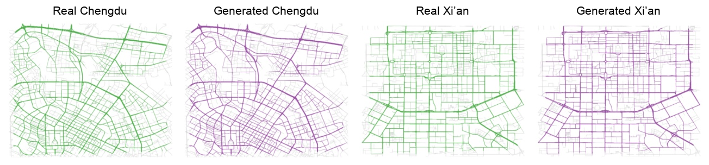

# [NeurIPS 2026] XTraj: A Coarse-to-Fine Autoregressive Framework for Transferable Trajectory Generation

> XTraj is a transferable coarse-to-fine autoregressive framework for road-consistent trajectory generation.

## Authors

**Chao Wang**<sup>1,*</sup>, **Zhiquan Lai**<sup>1,*</sup>, **Xinwei Fang**<sup>3</sup>, **Yuanshao Zhu**<sup>2,†</sup>, **Xun Zhou**<sup>1</sup>, **James Jianqiao Yu**<sup>1</sup>

<sup>1</sup> School of Computer Science and Technology, Harbin Institute of Technology, Shenzhen, China<br>
<sup>2</sup> City University of Hong Kong, Hong Kong SAR, China<br>
<sup>3</sup> Department of Computer Science, University of York, York, United Kingdom<br>
<sup>*</sup> Equal contribution; <sup>†</sup> Corresponding author

Contact: [Chao Wang](mailto:chaow@stu.hit.edu.cn), [Zhiquan Lai](mailto:zhiquanlai@stu.hit.edu.cn), [Yuanshao Zhu](mailto:yuanshao@ieee.org), [Xun Zhou](mailto:zhouxun2023@hit.edu.cn), [James Jianqiao Yu](mailto:jqyu@ieee.org)

## Links

- **Code Repository**: [GitHub](https://github.com/markLaiunimelb/XTraj)


## Table of Contents

- [Updates](#updates)
- [Introduction](#introduction)
- [Highlights](#highlights)
- [Method / Framework](#method--framework)
- [Project Structure](#project-structure)
- [Installation](#installation)
- [Dataset / Benchmark](#dataset--benchmark)
- [Usage](#usage)
- [Results](#results)
- [Demo / Visualization](#demo--visualization)
- [TODO](#todo)
- [Acknowledgement](#acknowledgement)
- [License](#license)

## Updates

- [10/2026] Initial code release.

## Introduction

This repository provides the official implementation of **“XTraj: A
Coarse-to-Fine Autoregressive Framework for Transferable Trajectory Generation.”**

**XTraj** addresses three challenges in vehicle trajectory generation:
geographic overfitting, fixed-length output, and off-road GPS drift. It combines
multimodal road representation learning with a coarse-to-fine autoregressive
pipeline: a GATv2 encoder learns road embeddings from geometry, POI context,
traffic heat, and topology; a road-level generator produces connected routes;
and a GPS-level decoder predicts monotonic progress along those routes.

This design supports variable-length generation and cross-city transfer without
additional parameter training, while keeping generated GPS points on road
geometry without post-hoc map matching. Experiments on Xi’an and Chengdu
demonstrate improved spatial fidelity over competitive baselines.

The repository includes training and inference code, road-embedding export,
road-progress data processing, GPS reconstruction utilities, and qualitative
visualizations.

## Highlights

- **Transferable road representations:** a multimodal GATv2 encoder combines
  road geometry, POI context, traffic heat, and directed graph topology.
- **Variable-length route generation:** an autoregressive road-segment generator
  applies neighbor and destination-directed constraints during decoding.
- **Road-consistent GPS refinement:** a route-aligned progress decoder predicts
  non-negative progress increments and interpolates points on road geometry.
- **Cross-city transfer:** the paper evaluates training-free transfer across
  Xi'an and Chengdu, with additional unseen-city transfer analysis in the appendix.
- **Fine-grained fidelity:** multi-resolution spatial evaluation and road-alignment
  analysis measure both distributional realism and physical validity.

## Method / Framework

XTraj uses a coarse-to-fine, three-stage generation pipeline. The road-level
modules operate on a directed road graph, while the final module generates
route-relative progress values instead of unconstrained longitude/latitude
coordinates.

1. **Transferable road-segment encoder** (`models/gat_multimodal_encoder.py`)
   projects geometry, POI context, and historical traffic heat into a shared
   representation and propagates it with a multi-head GATv2 over the directed
   road graph. A masked trajectory reconstruction objective masks 30% of
   interior road tokens and trains the encoder to recover them. The resulting
   64-dimensional road embeddings are exported and frozen for downstream use.
2. **Road-segment autoregressive generator**
   (`models/traj_ar_transformer.py`) predicts the next road segment from the
   route prefix and trip conditions such as origin, destination, departure time,
   and duration. A topology mask restricts candidates to legal outgoing
   neighbors. During decoding, a destination-directed shortest-path constraint
   filters candidates that would move farther from the destination, and
   generation stops when the destination is reached. This produces variable-
   length routes.
3. **Road-aligned GPS generator** (`models/road_progress_decoder.py`) represents
   each point as `s = i + alpha`, where `i` is the route segment index and
   `alpha` is the within-segment arc-length ratio. An encoder-decoder Transformer
   predicts non-negative progress increments with a Softplus output head. Each
   predicted progress value is deterministically interpolated on the selected
   road polyline, keeping generated GPS points on valid road geometry.

The implementation is organized around the corresponding training, preprocessing,
embedding export, route generation, and GPS reconstruction scripts in
`experiments/`, `models/`, and `utils/`.

## Project Structure

```text
.
├── assets/                             # README visualization assets
│   └── visualization/
├── experiments/                         # Training, preprocessing, and generation entry points
│   ├── train_encoder_linkpred.py        # Stage 1: road encoder training
│   ├── export_road_embeddings.py        # Export road embeddings
│   ├── train_traj_ar_transformer.py     # Stage 2: segment-level generator training
│   ├── build_reachability_table.py      # Build graph-reachability artifacts
│   ├── build_road_progress_dataset.py   # Build point-level training data
│   ├── train_road_progress_decoder_ddp.py # Stage 3: point-level decoder training
│   ├── sample_and_generate_trajectories.py
│   ├── batch_generate_trajectories.py
│   ├── batch_generate_gps_from_road_progress.py
│   ├── batch_generate_gps_from_road_progress_full.py
│   └── reconstruct_gps_from_road_progress.py
├── models/                              # Neural network definitions
├── utils/                               # Datasets, graph, sampling, and geometry utilities
├── requirements.txt
└── README.md
```

## Installation

### 1. Clone the repository

```bash
git clone https://github.com/markLaiunimelb/XTraj.git
cd XTraj
```

### 2. Create an environment

```bash
python -m venv .venv
source .venv/bin/activate       # Linux / macOS
# .venv\Scripts\activate      # Windows
```

### 3. Install dependencies

```bash
pip install -r requirements.txt
```

`torch-geometric` may require a PyTorch/CUDA-matched wheel. See the
[PyTorch Geometric installation guide](https://pytorch-geometric.readthedocs.io/en/latest/install/installation.html)
when the default installation does not provide a compatible wheel.

## Dataset

The paper evaluates XTraj on real-world vehicle trajectories from **DIDI
Chuxing** in Xi'an and Chengdu. The road networks are directed graphs extracted
from **OpenStreetMap**, and POI context is collected from the **AMap API**.
Historical road-segment visit frequencies provide the traffic-heat features.

The scripts expect a city-specific data root with the following layout:

```text
<data-root>/
├── <city>/                                # Raw trajectory files
│   └── *.npy
├── <city>_road_network/
│   ├── edges.csv
│   └── road_poi_stats.json                # Optional POI statistics
└── <city>_road_progress/                  # Generated by the preprocessing step
    └── road_progress_1s/
        └── *.npy
```

Raw trajectory samples have the form `[meta, gps_points]`. Each GPS point
contains longitude, latitude, road ID, and an optional time value. The road
network CSV must provide at least `fid`, `u`, `v`, and `wkt`; `length` and POI
fields are optional where supported by a selected script.


The dataset is not redistributed with this repository. Replace the example
paths below with paths to an authorized local dataset.

The DIDI, OpenStreetMap, and AMap terms of use apply to their respective data.
Users should obtain and process those sources according to the original
providers' access and licensing requirements.

## Usage

### Stage 1: Train the road encoder

```bash
python experiments/train_encoder_linkpred.py \
    --city chengdu \
    --data-root /path/to/datasets \
    --traj-dir /path/to/datasets/chengdu \
    --save ./checkpoints/encoder.pt
```

### Stage 1: Export road embeddings

```bash
python experiments/export_road_embeddings.py \
    --city chengdu \
    --data-root /path/to/datasets \
    --traj-dir /path/to/datasets/chengdu \
    --ckpt ./checkpoints/encoder.pt \
    --out ./checkpoints/embedding/chengdu_embedding.pt
```

### Build the reachability table

```bash
python experiments/build_reachability_table.py \
    --city chengdu \
    --data-root /path/to/datasets \
    --output ./checkpoints/chengdu_C.npy
```

### Stage 2: Train the segment-level generator

```bash
python experiments/train_traj_ar_transformer.py \
    --city chengdu \
    --data-root /path/to/datasets \
    --traj-dir /path/to/datasets/chengdu \
    --emb ./checkpoints/embedding/chengdu_embedding.pt \
    --save ./checkpoints/segment_level_generator.pt
```

### Build the road-progress dataset

Run this once for each raw trajectory file:

```bash
python experiments/build_road_progress_dataset.py \
    --input /path/to/datasets/chengdu/20161001_order_gps.npy \
    --edges /path/to/datasets/chengdu_road_network/edges.csv \
    --output /path/to/datasets/chengdu_road_progress/road_progress_1s/20161001_order_gps.npy \
    --sample-seconds 1
```

### Stage 3: Train the point-level decoder

```bash
python experiments/train_road_progress_decoder_ddp.py \
    --data-dir /path/to/datasets/chengdu_road_progress/road_progress_1s \
    --emb ./checkpoints/embedding/chengdu_embedding.pt \
    --save ./checkpoints/point_level_generator.pt \
    --gpus 0,1,2,3
```

### End-to-end generation

```bash
python experiments/sample_and_generate_trajectories.py \
    --input-dir /path/to/datasets/chengdu \
    --output-dir ./sampled_generation/chengdu \
    --num-samples 1000 \
    --segment-ckpt ./checkpoints/segment_level_generator_epoch0005.pt \
    --point-ckpt ./checkpoints/point_level_generator.pt \
    --emb ./checkpoints/embedding/chengdu_embedding.pt \
    --city chengdu \
    --data-root /path/to/datasets \
    --edges /path/to/datasets/chengdu_road_network/edges.csv \
    --gpu 0
```

Generated outputs are written to `--output-dir`, including the sampled
original trajectories and generated trajectories.

All entry points expose `--help` for additional options. GPU hardware is
required for the multi-GPU training example and recommended for generation.

## Results

The paper reports lower-is-better Jensen-Shannon divergence (JSD) for spatial
Density, trajectory Length, and origin-destination Trip distributions. MMR is
the post-hoc map-matching rate, and Shift is the average correction distance.
The following values are the reported XTraj results at the main `256 x 256`
evaluation setting:

| Setting | City | Density | Length | Trip | MMR | Shift |
|---|---|---:|---:|---:|---:|---:|
| XTraj | Xi'an | 0.0592 | 0.0023 | 0.0073 | 0.0000 | 0.00 m |
| XTraj-Transfer | Xi'an | 0.0747 | 0.0163 | 0.0079 | 0.0000 | 0.00 m |
| XTraj | Chengdu | 0.0412 | 0.0035 | 0.0061 | 0.0000 | 0.00 m |
| XTraj-Transfer | Chengdu | 0.0780 | 0.0173 | 0.0048 | 0.0000 | 0.00 m |

For the paper's multi-resolution spatial analysis, JSD at `4096 x 4096`
(approximately `2 m x 2 m` cells) is `0.1552` for XTraj on Xi'an and `0.1566`
on Chengdu. The corresponding training-free transfer values are `0.1722` and
`0.1768`. The paper reports zero map-matching failure and zero average shift
for XTraj because GPS points are reconstructed directly on generated road
geometries.

## Visualization

The following city-level comparison is adapted from the paper. From left to
right: real Chengdu trajectories, XTraj-generated Chengdu trajectories, real
Xi'an trajectories, and XTraj-generated Xi'an trajectories.

<p align="center">
  
</p>

**Figure.** Real and XTraj-generated trajectories in Chengdu and Xi'an.

## TODO

- [ ] Add the final paper and project-page links.
- [ ] Release the dataset or document its access procedure.
- [ ] Add additional city-level and route-level visualizations.

## Acknowledgement

We acknowledge the providers of the DIDI Chuxing trajectory data, OpenStreetMap
road data, and AMap POI data used in the paper's experiments.

## License

This project is released under the Apache License 2.0.
